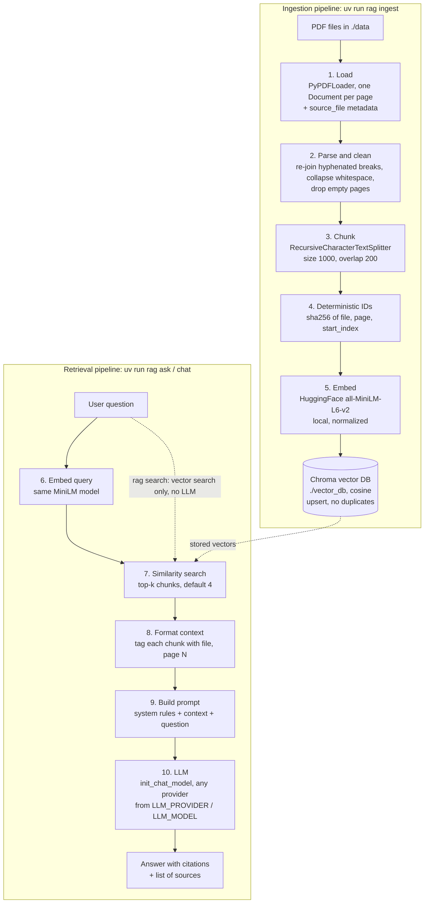

# PDF RAG pipeline (LangChain)

**Ingestion:** PDF → `PyPDFLoader` → text cleanup → `RecursiveCharacterTextSplitter` → HuggingFace embeddings (`all-MiniLM-L6-v2`, local) → Chroma vector DB (`./vector_db`)

**Retrieval:** user query → Chroma similarity search (top-k) → prompt with context → LLM (any provider via `init_chat_model`) → answer + sources

## How it works



### Step by step

**Ingestion** (`src/rag/ingestion.py`)

1. **Load**: every PDF under `./data` (or a path you pass) is read with `PyPDFLoader`. Each page becomes a `Document` tagged with `source_file`.
2. **Parse and clean**: words split by a hyphen at a line break are re-joined, runs of spaces and blank lines are collapsed, and empty pages are dropped.
3. **Chunk**: `RecursiveCharacterTextSplitter` cuts pages into ~1000-character chunks with 200 characters of overlap, splitting on paragraphs, then lines, then sentences. Each chunk records its `start_index`.
4. **Assign IDs**: each chunk's ID is a SHA-256 hash of `file | page | start_index`, so re-ingesting the same PDF updates existing chunks instead of duplicating them.
5. **Embed and store**: chunks are embedded locally with `all-MiniLM-L6-v2` (no API key needed) and upserted into a persistent Chroma collection using cosine distance.

**Retrieval** (`src/rag/retrieval.py`)

6. **Embed the query** with the same embedding model used at ingestion.
7. **Search**: Chroma returns the top-k most similar chunks (`RAG_TOP_K`, default 4). `rag search` stops here and prints the chunks with their scores.
8. **Format context**: retrieved chunks are joined, each prefixed with `[file, page N]`.
9. **Prompt**: a system prompt tells the model to answer only from the context, say "I don't know" when the answer isn't there, and cite sources.
10. **Generate**: the LLM configured by `LLM_PROVIDER` / `LLM_MODEL` writes the answer. The CLI prints it followed by the source pages.

## Setup

```bash
uv sync
cp .env.example .env   # set LLM_PROVIDER, LLM_MODEL, LLM_API_KEY
```

## Usage

```bash
uv run rag ingest                 # ingest every PDF in ./data (or pass a file/folder)
uv run rag search "query"         # vector search only, no LLM
uv run rag ask "your question"    # retrieve + generate
uv run rag chat                   # interactive prompt loop
```

Re-ingesting is idempotent: chunk IDs are deterministic, so existing chunks are updated rather than duplicated.

## Code

| File | Role |
|---|---|
| `src/rag/config.py` | Settings (all overridable via env / `.env`) |
| `src/rag/embeddings.py` | Shared embedding model + Chroma handle |
| `src/rag/ingestion.py` | Load → parse → chunk → embed → store |
| `src/rag/retrieval.py` | Retriever + LCEL RAG chain |
| `src/rag/__init__.py` | CLI |

## Switching LLM

The LLM is created with LangChain's `init_chat_model`, so any provider works. Install its package and set:

```bash
RAG_LLM_PROVIDER=groq RAG_LLM_MODEL=llama-3.3-70b-versatile   # needs langchain-groq + GROQ_API_KEY
RAG_LLM_PROVIDER=openai RAG_LLM_MODEL=gpt-4o-mini             # needs langchain-openai + OPENAI_API_KEY
```
